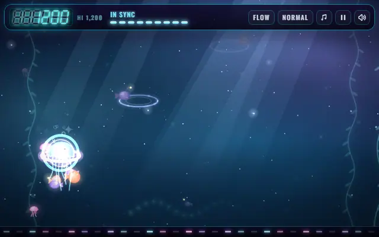
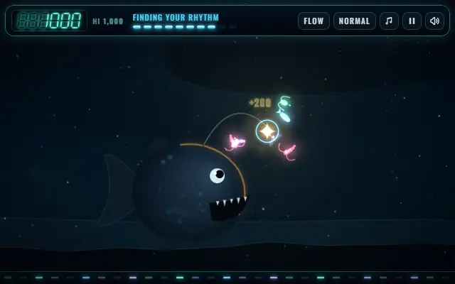
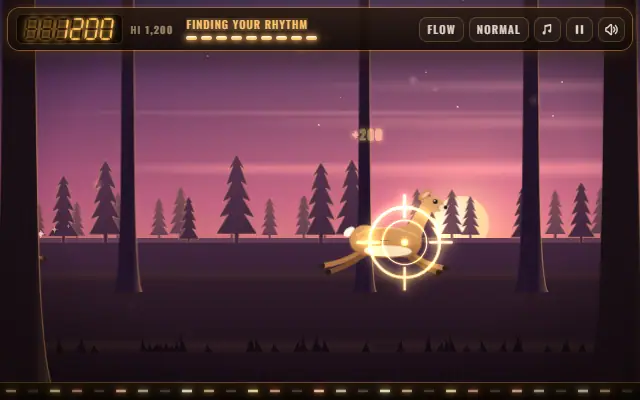
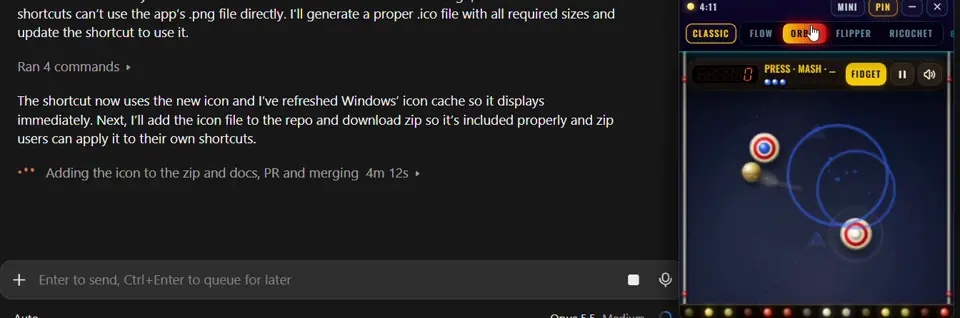

# Flow Engine

**Tiny rhythm games for the minute you spend waiting** on a build, a test run or an AI agent. Tap along and the music settles into *your* tempo. You can't lose, it never gets harder, and when you look away it plays itself.

<p>
  
  
  
</p>

<p align="center">
  <a href="https://kyleillgen.github.io/flow-engine/"><b>▶ Play in your browser</b></a> &nbsp;·&nbsp;
  <a href="https://github.com/kyleillgen/flow-engine/releases/latest/download/Flow-Pocket-windows.zip"><b>⬇ Flow Pocket for Windows</b></a> (2 MB)
</p>

## Why

Waiting on a machine is an awkward kind of break. It's too short to start something else, but long enough to reach for your phone and lose ten minutes. These games are made for that gap: something for your hands while your head stays on the problem, and an easy way back when the wait is over.

- **It finds your tempo.** Tap at whatever pace feels natural and the music moves to meet you, instead of making you chase a track.
- **You can't lose.** Misses cost nothing. There's no game over, and you're always one tap from being back in the groove.
- **It never ramps up.** Nothing speeds up or gets harder the longer you play. The challenge only changes when you pick chill, normal or intense (the **`** key).
- **It lets you go.** Look away and it plays itself. After a minute untouched the music fades out, and in the pocket a "Claude is done" cue tells you when to switch back.
- **Fidget mode** (press **F**) turns it into a toy: every press lands, with no score and no timing, just the feel of it.

The design follows research on flow, rhythm and attention breaks. That includes the honest part: a one-minute game can lift your mood and let a problem simmer, but it won't make you more productive, and the docs say so. The full read is [docs/flow-engine-research.md](docs/flow-engine-research.md).

## 30 games in seven cartridges

Every game is one button: **Space** or tap.

| Cartridge | |
|---|---|
| **Space** | Little aliens, a glowing jellyfish, a moon garden, a whale and the stars. |
| **Arcade** | A late-night cabinet: a brick-breaker, a maze, a highway crossing, a rock field and a claw machine. |
| **Cozy** | A moonlit garden: tea that blooms, an axolotl's pond, a cloud bakery and a moon moth. |
| **Lo-fi Cafe** | Rain on the window, latte art, steam off the cups and Biscuit the sleepy cat. |
| **Hunt** | A woods lodge at dusk: deer, birds, a wild turkey and a gallery booth. Nothing gets hurt: every animal is tagged and bounds off happy. |
| **Deep Sea** | An anglerfish's lantern, a chain of living light, a little sub's headlamp and a squid that talks in flashes. |
| **Classic** | The first four, on a pinball table: a ribbon, a bumper orbit, flippers and a wall-kick shaft. |

The browser version runs on desktop and phone. In a game, **?** shows the keys.

## Flow Pocket: play beside your editor



A small always-on-top window that docks at the side of your screen, in a corner, or as a tiny square.

1. [Download the zip](https://github.com/kyleillgen/flow-engine/releases/latest/download/Flow-Pocket-windows.zip) and unzip it anywhere.
2. Double-click **Flow Pocket.cmd**. There's nothing to install, and it runs offline.
3. The first time, Windows says "Windows protected your PC" because the app isn't code-signed. Click **More info**, then **Run anyway**.

It's light by design. It draws 60 frames a second while you play, 30 while it plays itself and 10 once it's been left alone for ten minutes, and it backs off by itself when your machine is busy. Nothing it runs touches the network: settings and scores stay in `%USERPROFILE%\.flow-pocket`.

The pocket is Windows only for now. On macOS or Linux, use the browser version.

### Let it tell you when Claude Code is done

The pocket has a lamp:
- **Yellow** while Claude Code works, with a timer.
- **Green with a chime** when Claude Code finishes.
- **Red** when Claude Code needs you.

Add these hooks to `~/.claude/settings.json`, merged with any you already have. Point them at `signal.mjs` in the folder you unzipped; they need [Node.js](https://nodejs.org).

```json
{
  "hooks": {
    "UserPromptSubmit": [{ "hooks": [{
      "type": "command", "async": true, "timeout": 5,
      "command": "node \"C:/path/to/Flow Pocket/signal.mjs\" start"
    }] }],
    "Stop": [{ "hooks": [{
      "type": "command", "async": true, "timeout": 5,
      "command": "node \"C:/path/to/Flow Pocket/signal.mjs\" done"
    }] }],
    "Notification": [{ "hooks": [{
      "type": "command", "async": true, "timeout": 5,
      "command": "node \"C:/path/to/Flow Pocket/signal.mjs\" needs"
    }] }]
  }
}
```

`signal.mjs` writes one line to a file the pocket watches. It swallows its own errors, so it can't slow down or block Claude Code. Any tool can use it: put `node signal.mjs done` at the end of a build script and the pocket chimes when the build finishes. More in [pocket/README.md](pocket/README.md).

## Make your own game

A game is one HTML file. You bring one idea: something that arrives on the beat, and one thing the player does about it. The engine brings the rest:
- music that follows the player,
- timing and scoring,
- streaks and tiers,
- autoplay,
- Fidget mode,
- pause and keys.

1. Copy [`games/template.html`](games/template.html) (Drop Catch, about 100 lines).
2. Follow [docs/build-on-the-engine.md](docs/build-on-the-engine.md). It covers the rules, the size and CPU budget, and a prompt you can hand to an AI assistant to build one with you.
3. Up to six games make a **cartridge**. `npm run cart new <id> "<Name>"` starts one, and `node pocket/setup.mjs --sync` puts it in a pocket you run from a clone.

New games and cartridges are very welcome. See [CONTRIBUTING.md](CONTRIBUTING.md).

<details>
<summary><b>How it's built</b></summary>

| Folder | What's in it |
|---|---|
| `engine/` | Tempo matching, generated music, streaks and tiers, pacing, autoplay, Flow and Fidget, frame rates. One file, no dependencies. |
| `shell/` | The frame around a game: HUD, input, scoring, pause, keys and the frame loop. |
| `skins/` | The look of each cartridge. |
| `games/` | One HTML file per game. Its header comment says how it plays. |
| `carts/` | Cartridges, and `cart.mjs` to check, play-test, measure and pack them. |
| `pocket/` | The Windows app ([Neutralinojs](https://neutralino.js.org) on the WebView2 engine built into Windows). `node pocket/package.mjs` builds the download. |

- `npm test` runs the engine's tests.
- `npm run smoke` loads and plays every game in a headless browser.
- `npm run cart check` checks every cartridge's rules and size.
- `npm run cart play <id>` measures each game's drawing time, memory and CPU against the budget.
- Pushing a tag like `v1.0.3` builds a release with the Windows download and each cartridge as a `.cart` file.

Every design change is checked against the research in [docs/flow-science-check.md](docs/flow-science-check.md). The engine's API is documented in [docs/flow-engine.md](docs/flow-engine.md).

</details>

## License

MIT. The bundled fonts, Oswald and Inter, are under the SIL Open Font License 1.1.
