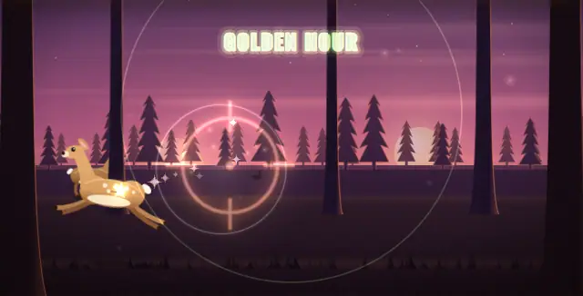

# Flow Engine

Little rhythm games for the minute you're waiting: a build, a test run, an AI assistant thinking. Tap along and the music falls into your rhythm. You can't lose, nothing speeds up, and when you look away it keeps playing by itself.

**[Play in your browser](https://kyleillgen.github.io/flow-engine/)** · **[Download Flow Pocket for Windows](https://github.com/kyleillgen/flow-engine/releases/latest/download/Flow-Pocket-windows.zip)** (2 MB)

## Seven cartridges

| | |
|---|---|
| **Space** | Little aliens, a glowing jellyfish, a moon garden, a whale and the stars. |
| **Arcade** | A late-night cabinet: a brick-breaker, a maze, a highway, a rock field and a claw machine. |
| **Cozy** | A moonlit garden: tea that blooms, an axolotl's pond, a cloud bakery and a moon moth. |
| **Lo-fi Cafe** | Rain on the window, latte art, steam off the cups and Biscuit the sleepy cat. |
| **Hunt** | A woods lodge at dusk: deer, birds, a wild turkey and a gallery booth. |
| **Deep Sea** | An anglerfish's lantern, a chain of living light and a squid that talks in flashes. |
| **Classic** | The first four, on a pinball table: a ribbon, a bumper orbit, flippers and a wall-kick shaft. |

Every game is one button. **Space** or tap to play, **F** for Fidget (every press lands, just for the feel of it), and **`** for chill, normal or intense.

## Flow Pocket

A small window that sits on top of everything else, beside your editor. Unzip it and double-click **Flow Pocket.cmd**; there's nothing to install, and it runs offline. Windows will warn you the first time, because the app isn't code-signed: click **More info**, then **Run anyway**.

If you use Claude Code, the pocket can light up when Claude finishes or needs you, so you can play while it works and know when to come back. [pocket/README.md](pocket/README.md) has the two-minute setup.

## Why it feels good

Most games get harder until you fail. These do the opposite, on purpose. They're built around what research says puts people in a state of flow: a clear goal, instant feedback, and a challenge that matches you instead of outrunning you. The engine listens to your timing and settles the tempo there. Misses cost nothing, and you're never more than one tap from being back in the groove. The longer read is in [docs/flow-engine-research.md](docs/flow-engine-research.md).

## Make your own

A game is one HTML file. You bring one idea, something that arrives on the beat and one thing the player does about it, and the engine brings the music, timing, scoring and autoplay. Copy [`games/template.html`](games/template.html) and start from [docs/build-on-the-engine.md](docs/build-on-the-engine.md), which also has a prompt to hand to an AI assistant. A set of up to six games becomes a cartridge the pocket can play.

For contributors

| Folder | What's in it |
|---|---|
| `engine/` | Tempo matching, music, streaks, pacing, autoplay, Flow and Fidget. One file, no dependencies. |
| `shell/` | The frame around a game: HUD, input, scoring, pause and keys. |
| `skins/` | The look of each cartridge. |
| `games/` | One HTML file per game. |
| `carts/` | Cartridges, and `cart.mjs` to check, play-test and pack them. |
| `pocket/` | The Windows app. `node pocket/package.mjs` builds the download. |

- `npm test` runs the engine's tests, and `npm run smoke` loads every game in a headless browser.
- `npm run cart check` checks every cartridge's rules and size. `npm run cart play <id>` measures each game's drawing time, memory and CPU.
- Pushing a tag like `v1.0.1` builds a release with the Windows download and each cartridge as a `.cart` file.

The design is checked change by change against the research in [docs/flow-science-check.md](docs/flow-science-check.md). See [CONTRIBUTING.md](CONTRIBUTING.md) for how changes land.

MIT. The bundled fonts (Oswald, Inter) are under the SIL Open Font License 1.1.
